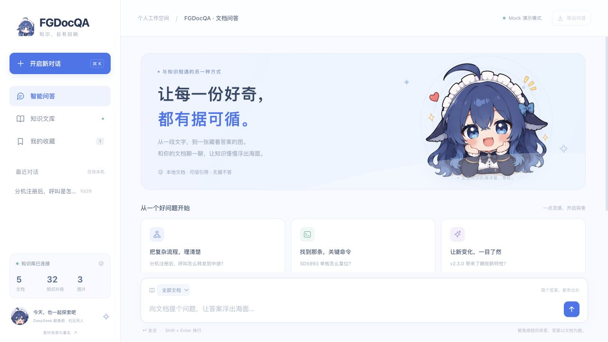

# FGDocQA
华为课结课作业，纯vibe做着玩的QAQ

一个在本机运行的文档问答工作台：把 PDF、Word、PPT、Markdown 和 TXT 整理成可检索的知识库，通过混合检索找到相关片段，再生成带来源的回答。

提供 **Mock 离线演示**和 **HTTP API 模型接入**两种使用方式，也支持只给聊天接 API。前端采用海洋风格与社区 DeepSeek 鲸鱼娘素材，支持会话历史、收藏、文库浏览和图文阅读。



## 功能

- **文档解析**：支持 `.pdf`、`.docx`、`.pptx`、`.md`、`.markdown`、`.txt`，提取正文和支持格式的内嵌图片。
- **图片释义**：可调用视觉模型生成图片描述，与正文一起入库；Mock 模式使用图注与规则替代。
- **混合检索**：稠密向量、BM25、本地 TF-IDF 稀疏检索，经过 RRF 融合与精排。
- **带来源问答**：展示引用片段、文档名、页码和图片信息；证据不足时返回“无据不答”。
- **浏览器工作台**：分类筛选、正文搜索、分页阅读、图片预览、回答收藏、复制与 Markdown 导出。
- **命令行工具**：解析、建库、检索、问答、评估、目录监控、环境检查和接口探测。

会话与收藏保存在当前浏览器中，清理站点数据会删除记录。历史会话用于整理问答，每次提问仍独立检索，当前不将完整历史作为多轮聊天上下文发送。

## 选择运行方式

| 方式 | 需要 API Key | 实际行为 | 适合场景 |
| --- | --- | --- | --- |
| [Mock 模式](#mock-模式无需-api-key) | 否 | 哈希向量、词面精排、规则图片释义、片段式回答 | 离线体验、开发与演示 |
| [API 模式](#api-模式接入真实模型) | 云服务通常需要 | 已启用的能力调用真实 HTTP 接口 | 使用真实语义检索与生成 |
| [仅聊天接 API](#仅聊天接-api保留-mock-检索) | 聊天服务需要 | 检索仍为 Mock，回答由聊天模型生成 | 先体验生成能力 |

**Mock 能跑通完整流程，但不代表真实模型效果，也不会下载或在本机运行这些大模型。** API 模式通过你配置的服务调用模型。

## 安装与准备

需要 **Python 3.9+**。以下命令在项目根目录执行，适用于 macOS / Linux；Windows 建议使用 WSL，并在 WSL 中安装 Python、执行相同步骤。

```bash
git clone https://github.com/zzhseu1108/HUAWEIhomework-FGDocQA.git
cd HUAWEIhomework-FGDocQA

python3 -m venv .venv
source .venv/bin/activate
chmod +x run.sh

# 首次创建配置；已有 .env 时保留现有文件
cp -n env.example .env
```

基础流程只依赖 Python 标准库，不需要 Node.js 或 GPU。若要解析 PDF，另外安装：

```bash
python3 -m pip install -r requirements.txt
```

其中 `pypdf` 用于 PDF 解析，`Pillow` 用于 PDF 图片提取。Markdown、TXT、DOCX、PPTX 以及自带演示无需这一步。

`run.sh` 会自动加载根目录的 `.env`。请**直接编辑 `.env`**；其中的同名配置会覆盖启动前在终端中设置的环境变量。配置采用 shell 语法，Key 建议放在单引号内，不要添加 `Bearer ` 前缀。

## Mock 模式：无需 API Key

### 1. 设置模式

编辑 `.env`，确保以下五项均为 `mock`。其余模型名称可保留样例值，Mock 不会调用它们。

```dotenv
DOCQA_MODEL_MODE=mock
DOCQA_EMBED_MODE=mock
DOCQA_RERANK_MODE=mock
DOCQA_CHAT_MODE=mock
DOCQA_VL_MODE=mock
```

### 2. 生成演示知识库

```bash
./run.sh doctor
./run.sh demo
```

`demo` 会解析 `examples/docs/`，构建默认索引，执行示例问答和评估。演示语料为虚构业务场景，包含 5 篇文档和 3 张图片。生成结果位于 `data/parsed/`、`data/index/` 和 `data/eval_report.json`。

注意：`demo` 使用当前 `.env`，不会强制切换到 Mock；运行前需完成上面的配置。它会重新生成默认演示库。

### 3. 启动网页

```bash
./run.sh serve --index data/index --port 8770 --open
```

浏览器访问 [http://127.0.0.1:8770](http://127.0.0.1:8770)。保持终端运行，按 `Ctrl+C` 停止服务。

可以直接点击页面中的示例问题，也可以在命令行中检索和问答：

```bash
./run.sh query "SD5993 单板怎么复位？" --index data/index --top-k 6
./run.sh ask "分机注册后，呼叫是怎么转发到中继的？" --index data/index --show-trace
```

## API 模式：接入真实模型

需要准备服务商的 **Base URL、有效 API Key 和准确的模型 ID**。Key 应具有相应模型的调用权限。项目通过标准 HTTP 请求调用接口，不要求安装厂商 SDK。

下面以 Gitee AI / 模力方舟的配置为例。示例模型 ID 是否对你的账号可用，以服务商控制台与实际探测结果为准；其他服务也可以使用相同配置方式，但接口路径和响应格式须兼容。

### 1. 编辑 `.env`

将下列配置写入 `.env`，把占位 Key 替换为你自己的有效令牌：

```dotenv
DOCQA_MODEL_MODE=http
DOCQA_BASE_URL=https://ai.gitee.com/v1
DOCQA_API_KEY='替换为你的有效API令牌'

DOCQA_EMBED_MODE=http
DOCQA_EMBED_MODEL=Qwen3-Embedding-8B

DOCQA_RERANK_MODE=http
DOCQA_RERANK_MODEL=Qwen3-Reranker-8B

DOCQA_CHAT_MODE=http
DOCQA_CHAT_MODEL=deepseek-v4.1-flash
# 留空时，聊天继承上面的通用地址和 Key
DOCQA_CHAT_BASE_URL=
DOCQA_CHAT_API_KEY=

# 暂未配置视觉服务时，图片释义继续使用 Mock
DOCQA_VL_MODE=mock
DOCQA_VL_MODEL=Qwen3.6-27B-VL

DOCQA_TIMEOUT=30
DOCQA_EMBED_DIM=512
```

这里启用了真实 Embedding、Reranker 和 Chat，VL 保持 Mock，因此属于 **混合模式（内部标记为 `mixed`，回答信息显示“HTTP + 本地”）**。如果服务商不支持某项能力，将对应的 `DOCQA_*_MODE` 设为 `mock`。

### 2. 检查配置并验证接口

```bash
./run.sh doctor
./run.sh probe
```

- `doctor` 只检查环境、配置和索引，**不会验证网络或 Key**。
- `probe` 逐项调用已设为 `http` 的能力，Mock 项会跳过。看到相应能力的“HTTP 已验证”才表示本次探测成功。
- 若返回 401、模型不存在或协议错误，先修正配置，再继续建库。探测和后续建库会产生真实 API 请求。

服务商参考：[向量化与重排接口](https://ai.gitee.com/docs/products/apis/embeddings/)、[DeepSeek 模型配置示例](https://ai.gitee.com/docs/integrations/Development-Tools/deepseek-harness)。

### 3. 解析并建立 API 索引

API 示例使用单独的目录，保留前面的 Mock 演示库：

```bash
./run.sh parse examples/docs --out data/parsed-api
./run.sh build data/parsed-api --index data/index-api
./run.sh doctor --index data/index-api
```

**首次接入真实 Embedding、切换 Mock / HTTP Embedding，或更换向量模型、维度时，都必须全量建库，不加 `--incremental`。** 查询时必须使用与建库相同的 Embedding 配置。只改聊天模型、聊天 Key 或精排配置，无需重建向量。

如果要启用真实图片理解，将 `DOCQA_VL_MODE=http`，并把 `DOCQA_VL_MODEL` 改为服务商支持图像输入的模型 ID；运行 `./run.sh probe` 验证后，重新执行 `parse` 和 `build`。仅执行 `build` 不会重新生成图片释义。

### 4. 启动 API 版网页

先用 `Ctrl+C` 停止已有服务，再启动：

```bash
./run.sh serve --index data/index-api --port 8770 --open
```

命令行同样要指定 API 索引：

```bash
./run.sh query "SD5993 单板怎么复位？" --index data/index-api
./run.sh ask "分机注册后，呼叫是怎么转发到中继的？" --index data/index-api --show-trace
./run.sh eval --index data/index-api --report data/eval_report-api.json
```

修改 `.env` 后需要重启 Web，刷新网页不会让后端重新加载配置。恢复 Mock 时，将四项能力与全局模式都改回 `mock`，再使用原来的 `data/index` 启动；若该库不存在，先运行 Mock 的 `demo`。

## 仅聊天接 API：保留 Mock 检索

如果暂时只有聊天 Key，编辑 `.env`：

```dotenv
DOCQA_MODEL_MODE=mock
DOCQA_EMBED_MODE=mock
DOCQA_RERANK_MODE=mock
DOCQA_VL_MODE=mock

DOCQA_CHAT_MODE=http
DOCQA_CHAT_BASE_URL=https://ai.gitee.com/v1
DOCQA_CHAT_API_KEY='替换为你的有效聊天API令牌'
DOCQA_CHAT_MODEL=deepseek-v4.1-flash
```

沿用 Mock 模式生成的 `data/index`，无需因聊天配置变化重新建库：

```bash
./run.sh probe
./run.sh serve --index data/index --port 8770 --open
```

若还没有 Mock 索引，先按 Mock 步骤生成，再切换聊天配置。这种方式同样属于混合模式，真实聊天不会将 Mock 检索自动升级为真实语义检索。

## 导入自己的文档

当前网页提供问答和阅读，**文档导入通过命令行完成**。先选好 `.env` 中的模型模式，再执行：

```bash
./run.sh parse "/绝对路径/你的文档目录" --out data/parsed-my --category 我的文档
./run.sh build data/parsed-my --index data/index-my
./run.sh serve --index data/index-my --port 8770 --open
```

`parse` 支持单个文件或目录；目录默认递归扫描。使用绝对路径时，含空格的路径要加引号。原始文档移动到其他电脑或路径后，应重新解析、建库，以更新本机溯源路径。

在 Embedding 配置不变的情况下，更新文档后可重新解析并增量建库：

```bash
./run.sh parse "/绝对路径/你的文档目录" --out data/parsed-my --category 我的文档
./run.sh build data/parsed-my --index data/index-my --incremental
```

如果删除了原始文档，手动 `parse` 不会清理旧解析结果，需要移除 `data/parsed-my/` 下对应文档的解析子目录，再重新建库。

也可以监控目录，定期解析并增量建库；该命令持续占用终端，可在另一个终端启动网页：

```bash
./run.sh watch --src "/绝对路径/你的文档目录" --parsed data/parsed-my --index data/index-my
```

`watch` 会跟踪本次持续运行期间发生的文档删除；启动前已经删除的旧文档，仍需按上面的方式清理解析结果。

内置 `examples/test_set.json` 仅适用于演示语料。自己的知识库需准备对应测试集，再执行 `eval --test-set "/路径/测试集.json" --index data/index-my`；字段示例见 [演示测试集](examples/test_set.json)。

## 配置与接口说明

| 配置项 | 含义 |
| --- | --- |
| `DOCQA_MODEL_MODE` | 默认模式：`mock` 或 `http`，默认 `mock` |
| `DOCQA_EMBED_MODE` / `DOCQA_RERANK_MODE` / `DOCQA_CHAT_MODE` / `DOCQA_VL_MODE` | 单项覆盖全局模式；留空继承全局值 |
| `DOCQA_BASE_URL` / `DOCQA_API_KEY` | 通用端点与令牌；Base URL 通常包含 `/v1`，不包含 `/embeddings` 等具体接口路径 |
| `DOCQA_CHAT_BASE_URL` / `DOCQA_CHAT_API_KEY` | 聊天独立端点与令牌；分别留空时继承通用值 |
| `DOCQA_EMBED_MODEL` / `DOCQA_RERANK_MODEL` | 服务商的向量化与精排模型 ID |
| `DOCQA_CHAT_MODEL` / `DOCQA_VL_MODEL` | 文本聊天与图片理解模型 ID |
| `DOCQA_TIMEOUT` | 单次 HTTP 请求超时秒数，默认 `30` |
| `DOCQA_EMBED_DIM` | 仅控制 Mock 哈希向量维度，默认 `512`；不会设置真实模型输出维度 |

单项模式的优先级更高。例如，即使全局设为 `http`，`DOCQA_EMBED_MODE=mock` 仍使用 Mock。只有聊天支持独立端点和 Key，Embedding、Reranker、VL 共用通用配置。

| 能力 | 项目调用的相对路径 | 响应要求 |
| --- | --- | --- |
| Embedding | `POST /embeddings` | 每条输入对应一个浮点向量；支持按 `index` 还原顺序 |
| Reranker | `POST /rerank` | 返回全部候选的 `index` 与 `relevance_score`（或 `score`） |
| Chat | `POST /chat/completions` | 返回 `choices[].message.content` 文本 |
| VL | `POST /chat/completions` | 支持含 Base64 `image_url` 的图文输入，并返回文本 |

仅支持聊天的 OpenAI 兼容服务不一定提供 `/rerank`，应逐项确认。当前第三路稀疏检索为 **`tfidf-local`**，没有接入 BGE-M3 的学习型稀疏权重；把 Embedding 模型名改成 `bge-m3` 不会自动启用 BGE-M3 稀疏检索。

## 常见问题

| 问题 | 处理方式 |
| --- | --- |
| 填了 Key，仍显示 Mock | 检查全局和四项能力模式、端点配置，并重启服务；Key 本身不会启用 HTTP |
| `doctor` 正常，但 API 不可用 | `doctor` 不发请求，使用 `./run.sh probe` 验证真实调用 |
| HTTP 401 / 403 | 检查令牌有效性、所属平台、模型权限，以及是否误加 `Bearer ` 前缀 |
| HTTP 404 / 模型不存在 | 检查 Base URL、模型 ID 和该服务是否提供所需接口 |
| 请求超时 / 限流 | 检查网络、服务商额度和限流；按需增加 `DOCQA_TIMEOUT` |
| 页面提示索引不存在 | 先完成 `parse` 和 `build`，确认 `serve --index` 指向建库目录 |
| 提示向量模型或维度不一致 | 使用建库时的 Embedding 配置，或对目标目录全量重建索引 |
| 能回答，但向量或精排有警告 | 查看检索轨迹和警告；部分失败会降级，能出答案不代表所有 API 已接通 |
| 8770 端口被占用 | 停止原服务，或改用 `./run.sh serve --index data/index --port 8771 --open`；API 库请相应修改 `--index` |
| 扫描 PDF 没有正文 | 当前没有完整 OCR 流程，建议先进行 OCR，得到可提取文字的文档 |

HTTP 向量化失败会使建库报错，不会用 Mock 向量替换旧库。检索时稠密召回失败会带警告降级，精排失败退回 RRF；聊天失败使用片段式回答，VL 失败回退到带标记的 Mock 释义。请以探测结果和警告判断各项能力状态。

## 开发与测试

```bash
make test
# 不依赖 make 的等价命令
PYTHONPATH=src:tests python3 -m unittest discover -s tests -v
```

测试覆盖解析、建库、召回、问答、Web 接口、图片访问边界、HTTP 响应校验、能力隔离与密钥脱敏。HTTP 协议测试使用模拟响应，不代表外部服务已通过鉴权。

```text
HUAWEIhomework-FGDocQA/
├── src/docqa/
│   ├── doc2md/          # 文档解析、图片提取与释义
│   ├── docbase/         # 切片、索引、混合检索与评估
│   ├── agent/           # 检索编排、生成与引用
│   ├── web/             # Python HTTP 服务与静态前端
│   ├── service/         # 目录监控
│   ├── llm.py           # 四类模型能力与 Mock 实现
│   └── cli.py           # 命令行入口
├── examples/            # 演示文档与测试集
├── tests/               # 单元与集成测试
├── docs/                # 设计与实施文档
├── assets/              # README 截图等展示素材
├── env.example          # 可公开的配置模板
├── AGENTS.md            # Agent 检索与溯源约定
└── run.sh               # 加载 .env 并启动命令
```

界面名称为 FGDocQA；Python 包仍为 `docqa`，配置变量仍使用 `DOCQA_` 前缀。更多实现细节见 [技术设计说明书](docs/02_技术设计说明书.md)。

## GitHub 使用与数据范围

这是一个需要 Python 后端的项目。上传 GitHub 后，其他人可以克隆并按上述步骤运行；**GitHub Pages 只能托管静态内容，无法直接运行本项目的问答后端**。

Mock 模式不调用外部模型接口。API 模式会向配置端点发送向量化文本、精排候选、问题和引用片段；启用真实 VL 后还会发送图片。使用云端 API 前，应确认文档可发送给该服务。

`.env`、虚拟环境、解析结果、索引和评估报告已在 `.gitignore` 中排除。上传前可用 `git status --short` 检查待提交文件；自己的原始文档也应放在仓库外，或另行加入忽略规则。README 与 `env.example` 中只保留占位 Key。

Web 默认监听 `127.0.0.1`，用于本机使用，目前没有多用户鉴权。DOCX 页码为估算值；旧 `.doc` / `.ppt` 需先转换为支持的格式，部分矢量图片格式会跳过并告警。

## 素材与许可

示例业务文档为虚构内容，仅供演示。DeepSeek 鲸鱼娘为社区同人素材，作者与 CC BY-NC-SA 4.0 许可见 [素材署名与许可](src/docqa/web/static/ARTWORK-LICENSE.md)；使用本形象不代表项目与 DeepSeek 官方存在关联。

DSH Web 图标的来源单独记录于同一说明文件，具体权利以原权利人授权为准。当前仓库未附统一代码许可证，美术素材许可不等同于代码许可。
