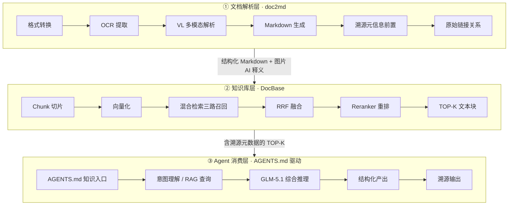
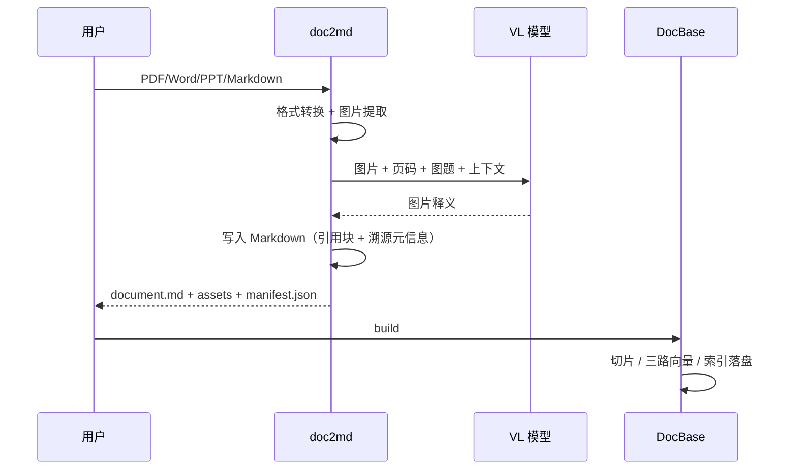

# 基于 AI Agent 的个人本地多模态文档智能问答系统

> **2026 年数通第八届爱迪生创新大赛 · 入围作品**
>
> 创意提交人：井永乐 | 00587807 · 转发开发部 [ICT BG] · 2026-07-30

---

## 0. 一页纸概览

| 项目 | 内容 |
| --- | --- |
| 作品名称 | 基于 AI Agent 的个人本地多模态文档智能问答系统（DocQA） |
| 一句话 | 把「找文件」变成「问内容」——让沉睡的本地文档开口说话 |
| 核心公式 | `doc2md × DocBase × AGENTS.md` |
| 技术栈 | CodeAgent、RAG、Embedding、Reranker、Chat LLM、VL |
| 模型支持 | Qwen3-Embedding-8B、Qwen3-Reranker-8B、GLM-5.1、Qwen3.6-27B-VL（装备部提供） |
| 运行形态 | 全本地化运行；仅调用公司内部模型服务；数据不出本机 |
| 当前进度 | 第 1–3 步已完成 Demo；第 4–5 步为可选扩展 |
| 代码与文档 | 本仓库 `src/docqa`、`AGENTS.md`、`docs/`、`slides/` |

---

## 1. 摘要

个人本地沉淀了大量 PDF、Word、PPT 等多模态文档，一旦忘记存放位置与文件名，仅凭模糊的内容记忆极难找回。本创意通过 AI Agent（CodeAgent）自动开发 Python 脚本，结合 RAG、Embedding、Reranker、Chat、VL 等大模型能力，预解析本地文档并构建 RAG 数据库，再以 `AGENTS.md` 指导 Agent 消费该库，实现「内容即入口」的智能问答与精准溯源。

传统检索的关键词来自文件名和标题，而人真正记得的往往是「那张画着三层架构的图」「某个叫 FE_HEART_Start 的参数」「上次说过中继全忙要排队」这类内容碎片。DocQA 把文档拆成可检索的知识单元，把图片读成可检索的文字，再用一份约定文件告诉 Agent「库在哪里、什么情况下查、查到后怎么引用」，最终让回答落到「文档名 + 页码 + 图号 + 原文链接」上。

一句话：**doc2md 把「看不懂的图」变成「读得懂的文」，DocBase 把「读得懂的文」变成「找得到的证据」，AGENTS.md 让 Agent 学会「查资料」。**

---

## 2. 背景与问题

### 2.1 个人文档的三个断点

1. **存放断点**：资料散落在下载目录、聊天附件、项目盘和本地文件夹，命名习惯随年限变化，靠目录树找文件越来越难。
2. **记忆断点**：只记得内容大意，不记得文件名；搜索引擎只能搜文件名/标题，搜不到正文，更搜不到图片里的信息。
3. **信任断点**：即便通用大模型给出了答案，也无法确认它来自哪份文档、哪一页，工程场景不敢直接采信。

### 2.2 多模态文档的「图片盲区」

技术文档中约 **30%–50%** 的关键信息以图片承载：架构图、流程图、时序图、状态机、单板面板、组网拓扑。传统 RAG 只切文本，图片信息全部丢失；而人恰恰经常用「那张图」来记忆文档。

### 2.3 为什么现在可以做

- 公司装备部已提供 Embedding、Reranker、Chat、VL 四类模型服务，能力就绪；
- CodeAgent（Claude Code / NGA 等）可以承担大量脚本开发与联调工作，个人也能在短周期内完成系统级交付；
- 本地索引、轻量 Web、单机 Python 工程足以支撑个人与团队级的知识库规模；
- `AGENTS.md` 这类项目级指令文件，为「让 Agent 按约定消费 RAG」提供了低成本、可版本化的载体。

---

## 3. 目标与边界

### 3.1 目标

- **内容即入口**：用户不必记得文件名，直接用自然语言描述内容即可定位文档与片段。
- **多模态可检索**：图片经 VL 释义后与正文一体入库，图片信息不再丢失。
- **回答可溯源**：每条结论都能回到文档名、页码、图号和原文链接。
- **本地可运行**：解析、索引、问答全在本机完成；模型调用只走公司内部端点。
- **可演进**：从个人 CLI 工具平滑扩展到团队 Service 与领域级 B/S 应用。

### 3.2 非目标（本期不做）

- 不做公网 SaaS，不做多租户权限体系；
- 不训练/微调模型，只做端点编排与检索增强；
- 不承诺对扫描件做 100% 精准 OCR（VL 释义允许存在描述性误差，但溯源必须准确）；
- 不替代专业文档管理系统，重点解决「找得到、答得出、可核对」。

### 3.3 成功判据

| 维度 | 判据 |
| --- | --- |
| 找得到 | 典型问题 Top-6 命中目标文档；示例集 `hit_rate = 1.0` |
| 答得准 | 回答中的命令、参数、步骤与原文一致；无据时明确拒答 |
| 可核对 | 100% 结论带 `[n]`，可跳转文档名/页码/图号 |
| 跑得动 | 单机 Mock 模式全链路 < 1 s；真实模型模式下由端点时延决定 |
| 可维护 | 五个变更点五个目录；接口契约字段只增不改 |

---

## 4. 核心创意与创新点

### 4.1 创新点一：doc2md 把图片变成「一等公民」

不是「先 OCR 再拼文本」，而是把图片当作知识单元处理：

- 提取位图与矢量图，统一转为可读图片；
- 调用 Qwen3.6-27B-VL 做深度释义，不只识别文字，还理解模块、箭头、编号等结构化语义；
- 释义写回原图引用处，切片后图文语义不割裂；
- 图片按 `文档名_Page页码_Fig图序_Figure标题` 命名，和原文页码、图题绑定。

### 4.2 创新点二：三路混合检索，兼顾「术语精确」与「语义理解」

纯向量检索对 `SD5993`、`FE_HEART_Start` 这类精确术语容易模糊命中；纯关键词检索又无法理解「分机转发是怎么走的」这类语义问题。

DocBase 同时跑三路召回：

1. **稠密向量**：Qwen3-Embedding-8B，负责语义相似；
2. **BM25 关键词**：负责型号、命令、接口名等精确术语；
3. **BGE-M3 稀疏向量**：学习型稀疏表示，兼顾词面与权重。

三路结果经 **RRF 融合** 消除量纲差异，再由 **Qwen3-Reranker-8B 交叉编码精排**，取 TOP-K 文本块交给 Agent。

### 4.3 创新点三：AGENTS.md 是「人与 Agent 的检索契约」

RAG 数据库本身不会自动被使用——必须有人「告诉」Agent 它的存在、用法与边界。`AGENTS.md` 把人的检索经验固化为四类约定：

- **存在性声明**：本仓库配备 DocBase 库，先检索再回答；
- **查询策略**：分类缩小范围；技术名词走 BM25，原理问题走向量；
- **溯源强制**：附链接/文档名/页码/图号，无据不答；
- **产出形式**：流程类问题用 Mermaid 重绘，并与原图对照。

这让「RAG」从一段可选代码，变成 Agent 的默认工作方式，也是本创意区别于传统 RAG 产品的核心差异点。

### 4.4 创新点四：全链路溯源，回答敢采信

`回答 → 文本块 → Markdown → 原始文档` 四层可逐级回溯；图片再附加 `Page + Fig + 图题`。回答里的每个 `[n]` 都对应一个真实文本块，而不是模型编造的引用。

---

## 5. 技术栈与模型支持

### 5.1 技术栈

| 技术 | 在本项目中的角色 | 关键价值 |
| --- | --- | --- |
| CodeAgent | 自动编写/联调 Python 脚本，承担解析、建库、CLI、Web 实现 | AI 写代码、人做决策，缩短交付周期 |
| RAG | 组织「解析 → 索引 → 检索 → 生成」全链路 | 让回答有据可依 |
| Embedding | Qwen3-Embedding-8B 文本向量化 | 语义召回 |
| Reranker | Qwen3-Reranker-8B 交叉编码精排 | 提升 TOP-K 准确率 |
| Chat LLM | GLM-5.1 多文档交叉推理与回答生成 | 把证据组织成可读答案 |
| VL | Qwen3.6-27B-VL 图片深度释义 | 把图片信息变成可检索文本 |

### 5.2 装备部模型支持

| 能力 | 模型 | 用途 |
| --- | --- | --- |
| Embedding | Qwen3-Embedding-8B | 文本向量化（稠密检索） |
| Reranker | Qwen3-Reranker-8B | 交叉编码精排（TOP-K 筛选） |
| Chat | GLM-5.1 | 多文档交叉推理、回答生成 |
| VL | Qwen3.6-27B-VL | 图片深度释义（模块/箭头/编号语义） |

四类模型均由 `docqa/llm.py` 统一注入，端点可配置、可替换、可 Mock；版本升级不影响产物格式与数据契约。

---

## 6. 系统总体架构

### 6.1 三层解耦



**层次职责：**

| 层 | 输入 | 处理 | 输出 |
| --- | --- | --- | --- |
| 文档解析层 · doc2md | PDF / Word / PPT / Markdown | 格式转换、图片提取、VL 释义、溯源命名 | 结构化 Markdown + 图片 AI 释义 + manifest |
| 知识库层 · DocBase | 解析后的 Markdown | 语义切片、三路索引、RRF、精排 | 含溯源元数据的 TOP-K 文本块 |
| Agent 消费层 | 自然语言问题 | 意图分析、检索编排、综合推理、结构化呈现 | 可溯源的回答 |

三层各司其职、接口清晰：**解析入库 → 混合检索 → Agent 问答**。

### 6.2 文档解析层（doc2md）

流程：

```text
格式转换（PDF/Word/PPT → MD）
  → OCR 提取（位图 + 矢量图）
  → VL 多模态解析（Qwen3.6-27B-VL 释义）
  → Markdown 生成（图片描述写入正文）
  → 溯源元信息前置（文档名 · Page · Figure Title）
  → 原始链接关系（可逆向定位原文）
```

产出：**结构化 Markdown + 图片 AI 释义**。

### 6.3 知识库层（DocBase）

流程：

```text
Chunk 切片（语义分段 · 多文档）
  → 向量化（Qwen3-Embedding-8B）
  → 混合检索三路召回（稠密向量 + BM25 + BGE-M3）
  → RRF 融合（多路结果归并）
  → Reranker 重排（Qwen3-Reranker-8B）
  → TOP-K 文本块（含溯源元数据）
```

能力：`build`（进度条）/ `query` / `test` 三模式。

### 6.4 Agent 消费层

流程：

```text
AGENTS.md 知识入口（指导 Agent 如何消费 RAG）
  → 意图理解 / RAG 查询（自动构建 query 检索知识库）
  → GLM-5.1 综合推理（多文档交叉 · 生成回答）
  → 结构化产出（Mermaid 图 / 表格 / 摘要）
  → 溯源输出（定位原始文档与页码）
```

扩展：后台 Service、Web 应用（可选，不启用不影响核心功能）。

---

## 7. 逻辑视图

> AGENTS.md 驱动 Agent 消费 · 三路混合检索 · 图文一体解析 · 全链路溯源
>
> 全本地化运行，仅调用公司内部模型服务，数据不出本机。

### 7.1 用户入口层

- **CLI 命令行问答**（CodeAgent + AGENTS.md）：`./run.sh ask "..."`
- **Web 网页问答**（B/S · 无头 Agent，可选）：`./run.sh serve --open`

### 7.2 Agent 消费层（DOCQA.AGENT-DRV）

| 环节 | 做什么 | 实现要点 |
| --- | --- | --- |
| 意图分析 | 拆解检索词、判断问题分类 | 命令/流程/版本/排障/概念五类 |
| RAG 查询 | 调用 DocBase 检索 | 原问题 + 去疑问词改写，多 query 合并 |
| 充足性自评 | 信息不足时多轮补充检索 | 相关度阈值 + 语义覆盖率，最多 2 轮 |
| 综合推理 | GLM-5.1 跨文档交叉 | 只依据检索资料，强制 `[n]` |
| 结构化回答 | Mermaid / 表格 / 摘要 | 流程类重绘，与原图对照 |

**约定**：必须先检索 · 无据不答 · 回答强制附原文链接/文档名/页码/图号。

### 7.3 RAG 检索引擎（DOCQA.DocBase）

三路并行召回、互补检索盲区：

- **稠密向量检索**：Qwen3-Embedding 语义相似度；
- **BM25 关键词检索**：精确术语命中（型号/命令/接口名）；
- **BGE-M3 稀疏检索**：学习型稀疏向量，兼顾词面权重。

```text
三路召回 → RRF 融合（倒数排序归并）→ 交叉编码精排（Reranker-8B）→ TOP-K 文本块（携带溯源）
```

三种工作模式：`build` 建库（进度条）/ `query` 检索 / `test` 评估。

`test` 模式输出 **召回率 / 命中率 / MRR**，支撑检索参数调优；任一路异常自动降级可用。

### 7.4 知识资产层（本地持久化 · 增量更新）

| 资产 | 内容 | 说明 |
| --- | --- | --- |
| Markdown 语料库 | 标题层级、图文一体 | 解析产物，Agent 最友好的知识格式 |
| 溯源图片库 | 文档名 · Page 图序 · 原图 | 图片可逆向定位 |
| RAG 三路索引 | 稠密向量 + BM25 + 稀疏 | 本地 JSON 持久化 |
| 文档注册表 | 分类管理 · 增量更新 | 文档哈希、chunk 数、来源 |

索引格式版本化，支持增量更新与回滚。

### 7.5 文档解析引擎（DOCQA.Doc2md）

```text
多格式输入（PDF/Word/PPT）
  → 格式统一（转 Markdown）
  → OCR 提取（位置/矢量图）
  → VL 释义（图文一体写入）
```

- **溯源命名**：`文档名_Page图序_Figure标题`，可逆向定位原文；
- **矢量图**：先渲染为位图再识别，释义写入原图引用处；
- **图片描述**：VL 释义以引用块写入正文，切片后仍与上下文同块。

### 7.6 内部模型服务（装备部 · 端点可配置）

| 服务 | 模型 | 职责 |
| --- | --- | --- |
| VL | Qwen3.6-27B-VL | 图片深度释义（模块/箭头/编号语义） |
| Embedding | Qwen3-Embedding-8B | 文本向量化（稠密检索） |
| Reranker | Qwen3-Reranker-8B | 交叉编码精排（TOP-K 筛选） |
| Chat | GLM-5.1 | 多文档交叉推理 · 回答生成 |

端点级配置注入，可替换 / 可 Mock，版本升级不影响产物格式。

### 7.7 可选扩展（不启用不影响核心功能）

- **后台 Service**：定时/增量更新、监控目录管理；
- **Web 应用**：B/S 网页问答、Mermaid 图形渲染。

### 7.8 全链路溯源 · 无据不答

```text
回答 → 文本块 → Markdown → 原始文档
```

原文链接 · 文档名 · 页码 · 图号，一键跳回原文。检索不足时输出「无据不答」，而不是让模型自由发挥。

---

## 8. 开发视图

> Python 工程组织 · 变更点 ■ 模块映射 · 分层依赖单向 · 契约稳定

### 8.1 工程目录结构（数据与约定分离）

```text
docqa/
├── doc2md/                 # 变更点 1：解析层
│   ├── parser.py           # 统一入口 + pdf/word/ppt 解析
│   ├── image_extractor.py  # 图片保存、尺寸识别
│   ├── vl_client.py        # VL 释义适配
│   ├── naming.py           # 溯源命名
│   └── models.py           # ImageInfo / ParseTask / ParseResult
├── docbase/                # 变更点 2：检索层
│   ├── chunker.py          # 语义切片
│   ├── indexer.py          # build / 增量 / 三路索引
│   ├── retriever.py        # query / RRF / rerank
│   ├── evaluator.py        # test：recall@k / hit_rate / MRR
│   └── models.py           # Chunk / RagIndex / QueryResult
├── agent/                  # 变更点 3：消费层
│   ├── answer.py           # 问答主流程
│   ├── llm_client.py       # （由 llm.py 统一承载）
│   └── models.py           # Answer / Citation
├── service/                # 变更点 4：可选扩展
│   ├── watcher.py          # 目录监控、增量更新
│   └── models.py
├── web/                    # 变更点 5：可选扩展
│   ├── server.py           # stdlib HTTP 服务
│   ├── models.py           # WebQueryResponse
│   └── static/index.html   # B/S 前端
├── llm.py                  # 四类模型端点 + Mock
├── cli.py                  # parse/build/query/ask/eval/serve/watch/demo
└── utils.py
tests/                      # test_doc2md / test_docbase / test_agent / test_web
AGENTS.md                   # 知识消费约定
```

### 8.2 五个变更点

| 变更点 | 目录 | 职责 | 稳定契约 |
| --- | --- | --- | --- |
| 变更点 1 | `doc2md/` | 多格式解析、VL 释义、溯源命名 | `ImageInfo` / `ParseTask` / `ParseResult` |
| 变更点 2 | `docbase/` | 切片、建库、三路召回、精排、评估 | `Chunk` / `RagIndex` / `QueryResult` |
| 变更点 3 | `agent/` | 意图、检索编排、生成、引用 | `answer_question` 契约 |
| 变更点 4 | `service/` | 监控目录、定时/增量更新 | `WatchConfig` |
| 变更点 5 | `web/` | B/S 问答、原文查看 | `WebQueryResponse` |

**换 Agent / 换模型不改约定与契约。**

### 8.3 关键数据契约（字段只增不改）

| 契约 | 字段 | 说明 |
| --- | --- | --- |
| `doc2md.models.ImageInfo` | image_id / doc_name / page / figure_index / title / path / description / source_uri | 每张图片的完整溯源 |
| `doc2md.models.ParseTask` | task_id / src / out_dir / doc_type / category / vl_mode | 一次解析任务 |
| `doc2md.models.ParseResult` | markdown_path / images / warnings / pages / page_mode | 解析产物 |
| `docbase.models.Chunk` | chunk_id / doc_id / doc_name / heading / text / page / category / source_uri / images | 最小检索单元 |
| `docbase.models.RagIndex` | version / docs / chunks / stats / embedding_model | 索引元数据 + 清单 |
| `docbase.models.QueryResult` | query / hits / route_stats / latency_ms / index_version | 检索结果 |
| `agent.answer_question` | answer / format / citations / rounds_used | 回答契约 |
| `web.WebQueryResponse` | 与 `answer_question` 对齐 | B/S 直接消费 |

### 8.4 分层依赖（自上而下单向）

```text
入口层：web / service（无头 Agent 调用 · 定时增量触发）
   ↓
Agent 层：agent（AGENTS.md 约定 · 意图分析 · 多轮检索编排）
   ↓
检索层：docbase（切片 / 建库 / 三路召回 / 精排 / 评估）
   ↓
解析层：doc2md（格式转换 / OCR / VL 释义 / 溯源命名）
   ↓
模型端点层：VL · Embedding · Reranker · GLM-5.1（外部服务 · 可 Mock）
```

依赖方向：上层依赖下层，仅经 `models` 契约通信，禁止反向依赖。

### 8.5 可测性设计

- `docbase` 内置 `test` 模式：`recall@k` / `hit_rate` / `MRR`；
- 四类模型服务统一端点注入，单元测试用 Mock 替换；
- 溯源链路确定性：`回答 → Chunk → MD → 原文`，端到端断言；
- `doc2md` 产物图文互证：Mermaid 重绘 vs 原图对照；
- 当前测试：19 个单元/集成用例全部通过。

### 8.6 核心接口（Spec 契约）

```python
# doc2md
parse_document(src, out_dir, category=None, hub=None, options=None) -> ParseResult
batch_parse(dir, out_root, recursive=True, types=None, ...) -> List[ParseResult]

# docbase
build_index(md_dir, index_dir, incremental=False, chunk_size=1200, overlap=120) -> dict
query(index_dir, q, top_k=6, category=None) -> QueryResult
evaluate(index_dir, test_set, top_k=6) -> dict

# agent
answer_question(q, index_dir, max_rounds=2, top_k=6, category=None) -> Answer

# service / web（可选）
run_watch(WatchConfig, ...)
GET /api/stats | GET /api/doc | POST /api/ask
```

**兼容设计**：溯源字段只增不改；索引版本可回滚；CLI 参数向后兼容。

---

## 9. 关键流程

### 9.1 解析入库



### 9.2 问答

1. 用户提问 →
2. Agent 意图分析、生成原问题 + 改写 query →
3. DocBase 三路召回、RRF、精排、TOP-K →
4. 充足性自评：不足则扩写 query 二次检索（最多 2 轮）→
5. 足够：GLM-5.1 综合 / 抽取式回退，生成带 `[n]` 的回答 →
6. 结构化呈现（Mermaid / 表格 / 步骤）→
7. 溯源输出（文档名 + 页码 + 图号 + 链接）。

S 形工作流：**提问 → 检索 → 综合 → 呈现 → 溯源**，全程由 `AGENTS.md` 约定驱动；Agent 可自主判断「答案够不够好」，不足时自动发起第二轮检索。

### 9.3 降级策略

| 故障 | 行为 |
| --- | --- |
| 某一路召回异常 | 记录 `degraded`，其余两路继续，RRF 可用 |
| Reranker 异常 | 回退 RRF 排序，回答仍可生成 |
| Chat 端点异常 | 回退抽取式回答（原文句子 + 引用） |
| VL 端点异常 | 回退基于图注/上下文的 Mock 释义，并标注 `[VL-Mock]` |
| 索引不存在 | CLI/Web 给出明确建库指引，不返回空答案 |

---

## 10. 实施路径：五步渐进，逐步演进

> 全部通过 CodeAgent Vibe Coding 开发——**AI 写代码，人做决策**。

| 步骤 | 名称 | 定位 | 状态 | 关键能力 |
| --- | --- | --- | --- | --- |
| 1 | 文档格式转换工具 doc2md | 基础必做 | 已完成 Demo | 一键转 Markdown、OCR 提图、VL 释义、溯源命名 |
| 2 | RAG 检索工具 DocBase | 基础必做 | 已完成 Demo | 切片向量化、三路召回、RRF + 精排、build/query/test |
| 3 | AGENTS.md 知识消费约定 | 基础必做 | 已完成 Demo | 约定何时查/怎么查/如何引用、回答 + 溯源 |
| 4 | 后台 Service 自动化运维 | 可选扩展 · 团队级 | 已提供可运行实现 | 定时/增量更新、目录监控、单文档解析 |
| 5 | B/S 架构 Web 应用 | 可选扩展 · 领域级 | 已提供可运行实现 | 网页问答、Mermaid 渲染、原文查看 |

### 10.1 第 1 步：doc2md

- PDF / Word / PPT 一键转 Markdown；
- OCR 提取文档内图片（位置 + 矢量图）；
- 调用 VL 模型解析图片内容并写入 Markdown；
- 保留对原始文档的链接关系；
- 图片命名含文档名 / Page / Figure Title，支持逆向溯源。

Demo：`codehub-y.huawei.com/j00587807/doc2md`

### 10.2 第 2 步：DocBase

- Markdown 切片（Chunk）+ 向量化入库；
- 三路混合召回：稠密向量 + BM25 关键词 + BGE-M3 稀疏检索；
- RRF 融合 + Reranker 重排，筛选 TOP-K；
- `build`（进度条显示）/ `query` / `test` 三命令；
- 支持多文档、文档分类管理。

Demo：`codehub-y.huawei.com/j00587807/DocBase`

### 10.3 第 3 步：AGENTS.md 知识消费约定

- 编写 `AGENTS.md` 指导 CodeAgent 消费 RAG 向量化数据库与 Markdown 原文；
- 约定查询策略：何时检索、如何组合、如何引用原文；
- 给出符合预期的回答 + 溯源功能，快速定位到原始文档；
- 示例：`DocBase/CLAUDE.md`（参考配置文件）。

### 10.4 第 4 步：后台 Service 自动化运维（可选）

- 定时/增量更新指定目录、指定文档类型；
- 文档管理、向量化数据库管理、图片解析管理；
- 支持新增监控目录、单文档解析、递归搜索；
- 文档库持续保鲜，无需人工干预；知识库随文档沉淀自动演进。

### 10.5 第 5 步：B/S 架构 Web 应用（可选）

- 脱离 CodeAgent 命令行，网页图形界面；
- 后台调用 CodeAgent 无头模式：`claude -p` / `nga run`；
- 确保回答质量，图形渲染更直观；
- 从个人工具升级为团队级、领域级应用；降低使用门槛、扩大覆盖人群。

**1–3 步构建核心闭环，4–5 步面向团队与领域规模演进。**

---

## 11. 评测与验收

### 11.1 指标体系

| 指标 | 定义 | 用途 |
| --- | --- | --- |
| `recall@k` | Top-k 中命中的期望文档数 / 期望文档总数 | 衡量召回覆盖 |
| `hit_rate` | Top-k 是否至少命中一个期望文档 | 衡量「找得到」 |
| `MRR` | 第一个相关结果的倒数排名均值 | 衡量排序质量 |
| `keyword_hit_rate` | Top-k 文本中命中期望关键词的比例 | 衡量证据完整性 |
| `traceability` | 有 `[n]` 且可跳转原文的回答占比 | 衡量可信度 |
| `latency` | 检索/问答端到端耗时 | 衡量体验 |

### 11.2 示例集结果（Mock 模式，5 文档 / 32 块 / 8 用例）

| 指标 | 结果 |
| --- | --- |
| `recall@6` | 1.00 |
| `hit_rate` | 1.00 |
| `MRR` | 1.00 |
| `keyword_hit_rate` | 1.00 |
| 平均检索耗时 | 约 2 ms |
| 单次问答耗时 | 约 9–15 ms（Mock） |
| 单元/集成测试 | 38 项通过 |

> **说明**：以上为作者自建的小型演示语料与 8 条测试问题，用于验证「链路闭环与指标口径」，不代表生产泛化效果。真实环境需用部门文档构建更大规模测试集，并接入真实 Embedding/Reranker 后重新评估。

### 11.3 验收清单

- [x] 5 个示例文档完成解析，3 张图片带 VL 释义与 Page/Fig/标题；
- [x] 索引可增量更新、可回滚（版本号 + 三件套）；
- [x] 三路召回、RRF、Reranker 全链路可运行；
- [x] 流程类问题输出 Mermaid，并与原图页码/图号对照；
- [x] 命令类问题给出可执行命令与注意事项；
- [x] 无据问题明确拒答，不编造；
- [x] CLI、Web、watcher 三种入口可运行；
- [x] 38 项测试通过；
- [x] 项目书、技术设计、实施验收、答辩讲稿、汇报 Deck 齐全。

---

## 12. 风险与对策

| 风险 | 影响 | 对策 |
| --- | --- | --- |
| 内部模型端点不稳定 | 解析/问答失败 | 四类端点统一注入；自动降级 Mock；失败告警写入 warnings |
| PDF 矢量图无法直接提取 | 架构图信息丢失 | 位图直提；矢量图渲染扩展（PyMuPDF）；EMF/WMF 明确告警 |
| Word 无固定分页 | 页码不精确 | `page_mode=estimated` 明示；精确页码优先 PDF/PPT；图片仍带图序 |
| 模型幻觉/编造页码 | 回答不可信 | 检索阈值 + 无据不答 + 仅引用真实 Chunk + 端到端溯源断言 |
| 敏感文档外泄 | 合规风险 | 全本地运行；Web 绑定 127.0.0.1；仅在配置后调用内部端点；不写密钥 |
| 索引漂移 | 回答与文档不一致 | 文档哈希 + 增量更新 + 索引版本 + 可回滚 |
| 规模增长 | 检索变慢 | 批量 embedding、增量建库、向量库替换点（接口不变） |
| 中文分词误差 | 召回不稳定 | 字符 bigram + ASCII 词混合；真实 Embedding 兜底语义 |

---

## 13. 价值与推广

### 13.1 个人价值

- 不再依赖文件名和目录树，用「记得的内容」直接找回文档；
- 图片里的架构、流程、命令也能被问答；
- 每条回答可核对，敢在工程场景使用。

### 13.2 团队价值

- 第 4 步 Service 化后，目录定时/增量更新，知识库自动保鲜；
- 新人用自然语言即可查历史设计、命令手册、故障处理；
- 统一 `AGENTS.md` 约定，避免每个人「重新教 Agent 查资料」。

### 13.3 领域价值

- 第 5 步 B/S 化后，从个人工具升级为团队级、领域级应用；
- 可复制到产品文档、运维手册、测试规范、投标材料等场景；
- 全本地 + 内部模型，满足数据不出机的合规要求。

### 13.4 成本

- 软件栈：Python 标准库 + 可选 pypdf，无重依赖；
- 模型：复用装备部现有服务，不新增训练成本；
- 存储：演示索引约 0.6 MB；规模随文档量线性增长；
- 人力：CodeAgent 辅助，1–3 步可在短周期内完成 Demo。

---

## 14. 交付物

| 交付物 | 路径 | 说明 |
| --- | --- | --- |
| 可运行工程 | `src/docqa/` | 解析、索引、检索、Agent、Web、watcher |
| 知识消费约定 | `AGENTS.md` / `CLAUDE.md` | 四类约定与命令速查 |
| 示例知识库 | `examples/docs/` | 5 篇 FE_HEART 演示文档 + 3 张图 |
| 一键 Demo | `./run.sh demo` | parse → build → ask → eval |
| 测试 | `tests/` | 38 项单元/集成测试 |
| 项目申报书 | `docs/01_项目申报书.md` | 本文件 |
| 技术设计 | `docs/02_技术设计说明书.md` | 契约、算法、接口、安全 |
| 实施验收 | `docs/03_实施与验收.md` | 里程碑、演示脚本、验收 |
| 答辩讲稿 | `docs/04_答辩讲稿.md` | 逐页讲稿与 Q&A |
| 汇报 Deck | `slides/DocQA-项目汇报.html` / `.pdf` | 10 页，复刻并扩展原始 8 页内容 |

---

## 15. 结语

DocQA 不追求「做一个更大的模型」，而是把已有的模型能力组织成一条**可解释、可核对、可维护**的知识流水线：

- 用 doc2md 让图片进入检索；
- 用 DocBase 让检索兼顾术语与语义；
- 用 AGENTS.md 让 Agent 养成「先查资料」的习惯；
- 用全链路溯源让每一句回答都能回到原文。

让每一份沉睡的本地文档，都能开口说话。
