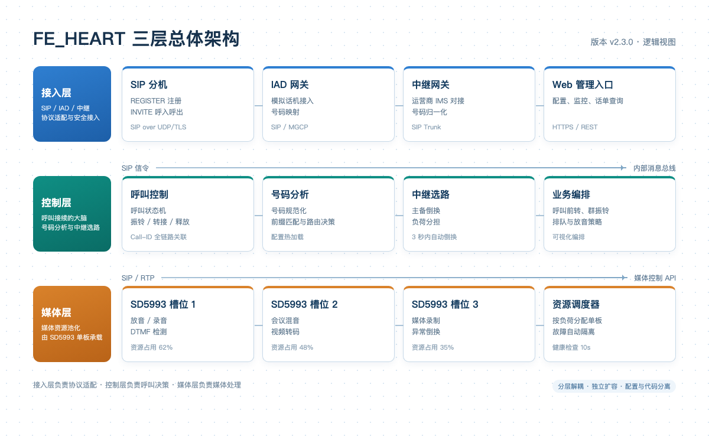

<!-- page: 1 -->
# FE_HEART 融合通信平台总体架构

FE_HEART 是面向企业分支的融合通信平台，承担分机接入、呼叫控制、中继选路和媒体处理四类核心能力。平台采用分层解耦设计，各层之间通过标准 SIP、RTP 与内部消息总线通信，便于按需扩容和独立升级。

## 1. 三层架构

平台由接入层、控制层和媒体层组成：

- **接入层**：提供 SIP 分机注册、中继网关接入和 Web 管理入口，负责协议适配与安全接入。
- **控制层**：包含呼叫控制、号码分析、中继选路和业务编排四个模块，是呼叫接续的大脑。
- **媒体层**：由 SD5993 媒体单板提供放音、录音、会议混音和视频转码能力。

图 1 FE_HEART 三层总体架构

## 2. 模块职责

| 模块 | 主要职责 | 关键接口 |
| --- | --- | --- |
| 接入网关 | 分机注册、鉴权、NAT 穿越 | SIP REGISTER / INVITE |
| 呼叫控制 | 呼叫状态机、振铃、转接、释放 | 内部呼叫 API |
| 号码分析 | 被叫号码规范化、前缀匹配、路由决策 | 号码分析表 |
| 中继选路 | 中继组选择、负荷分担、故障倒换 | 中继组配置 |
| 媒体处理 | 放音、录音、混音、转码 | SD5993 媒体 API |

## 3. 设计原则

1. **控制与媒体分离**：呼叫控制不直接处理媒体流，媒体资源由 SD5993 单板池化管理。
2. **配置与代码分离**：号码分析表、中继组和实例参数均通过配置文件注入，升级不改代码。
3. **可观测**：所有呼叫生成统一 Call-ID，日志、告警和话单均可按 Call-ID 关联。

<!-- page: 2 -->
## 4. 部署形态

FE_HEART 支持单机、双机和多节点集群三种部署形态。单机形态适用于 500 分机以内的小型分支；双机形态通过主备心跳实现 30 秒内倒换；集群形态按用户数分片，支持水平扩展。

## 5. 关键指标

- 单节点最大注册分机数：5000
- 呼叫建立时延：小于 200 ms（P95）
- 媒体转发容量：1000 路并发（G.711）
- 主备倒换时间：小于 30 s
- 配置变更生效时间：小于 5 s

## 6. 与其他系统的关系

FE_HEART 通过 SIP 中继与运营商 IMS 对接，通过 REST 接口向统一运维平台上报告警和性能数据，通过话单文件向计费系统提供原始计费记录。所有外部接口均支持 TLS 加密和 IP 白名单。
