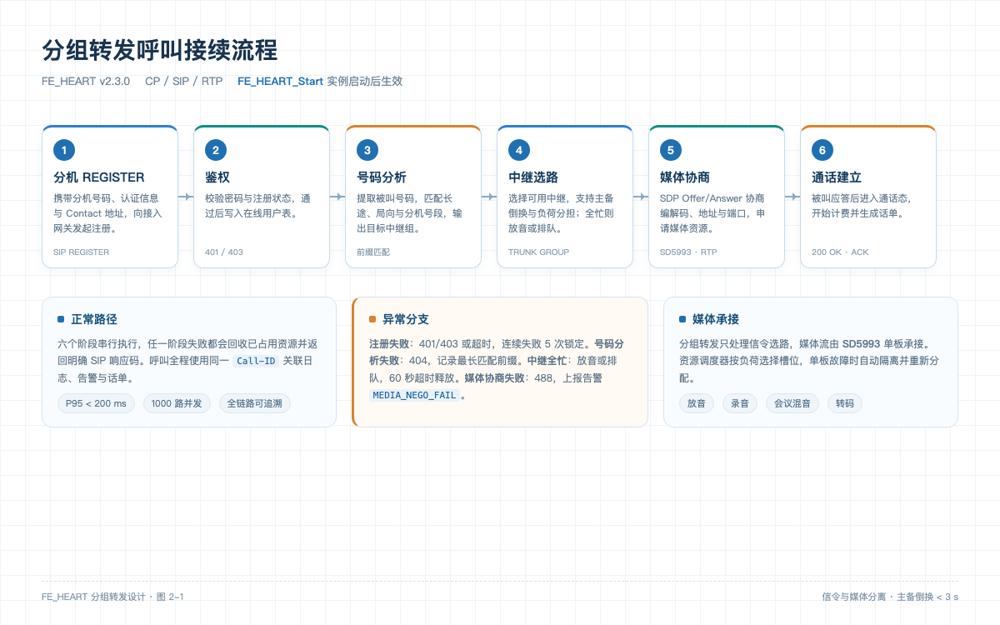

<!-- page: 1 -->
# 分组转发设计

分组转发（Packet Forwarding）负责把分机（SIP UA）的呼叫请求接入 FE_HEART，并按照被叫号码选择合适的中继组完成出局。它是 FE_HEART 呼叫接续链路的第一跳，直接决定呼叫能否被正确路由。

## 1. 设计目标

- 支持 SIP 分机、IAD 和 SIP 中继三类接入方式。
- 单节点支持 5000 分机同时注册，1000 路并发呼叫。
- 号码分析结果可配置、可追溯，变更不需要重启呼叫控制进程。
- 任一中继组故障时自动倒换到备用中继组。

## 2. 关键术语

- **FE_HEART_Start**：启动分组转发实例的入口参数集合，包含实例编号、中继组、注册超时等配置。节点启动时由运维脚本调用，加载成功后向呼叫控制模块注册转发能力。
- **SD5993**：媒体处理单板，提供放音、录音、混音与转码资源。分组转发只负责信令选路，媒体流由 SD5993 承接。
- **号码分析**：对被叫号码做规范化、前缀匹配和路由决策的过程，输出目标中继组。
- **中继组**：一组具有相同路由策略的中继电路，支持主备和负荷分担两种模式。

<!-- page: 2 -->
## 3. 呼叫接续流程

分机注册后，呼叫接续按以下六个步骤执行：

1. **分机注册**：分机向 FE_HEART 发送 REGISTER 消息，携带分机号码、认证信息和 Contact 地址。
2. **鉴权**：接入网关校验分机密码与注册状态，鉴权通过后把分机状态写入在线用户表。
3. **号码分析**：呼叫控制收到 INVITE 后提取被叫号码，依次匹配长途前缀、局向前缀和分机号段，得到目标中继组。
4. **中继选路**：根据中继组配置选择一条可用中继，支持主备倒换和负荷分担；若全部中继忙，则播放忙音或排队。
5. **媒体协商**：通过 SDP Offer/Answer 协商编解码、媒体地址和端口，媒体资源由 SD5993 单板分配。
6. **通话建立**：被叫振铃并应答后，呼叫进入通话态，开始计费并生成话单。

图 2-1 分组转发呼叫接续流程

### 3.1 FE_HEART_Start 参数

| 参数 | 默认值 | 说明 |
| --- | --- | --- |
| instance | 0 | 分组转发实例编号，同一节点内唯一 |
| trunk_group | default | 默认中继组名称 |
| register_timeout | 30 | 分机注册超时时间，单位秒 |
| media_board | auto | 媒体单板选择策略，auto 表示按负荷自动选择 SD5993 |

FE_HEART_Start 在节点启动时加载分组转发配置，并向呼叫控制模块注册转发能力。修改 instance 或 trunk_group 后需要重启分组转发实例才能生效；只修改号码分析表则支持热加载。

<!-- page: 3 -->
## 4. 异常处理

- **注册失败**：检查分机密码、注册服务器地址和防火墙 UDP 5060 端口；连续失败 5 次会触发防暴力破解锁定。
- **号码分析失败**：返回 404 Not Found，并记录被叫号码与匹配到的最长前缀，便于补配置。
- **中继全忙**：按中继组策略播放忙音或进入排队；排队超过 60 秒自动释放。
- **媒体协商失败**：回收已占用中继，返回 488 Not Acceptable Here，并上报告警 MEDIA_NEGO_FAIL。

## 5. 容量与性能

单实例分组转发在 8 核 16G 虚机上可支撑 1000 路并发呼叫，呼叫建立平均时延 85 ms，P95 小于 200 ms。中继选路采用哈希加最少连接数策略，避免同一中继组内出现热点。
