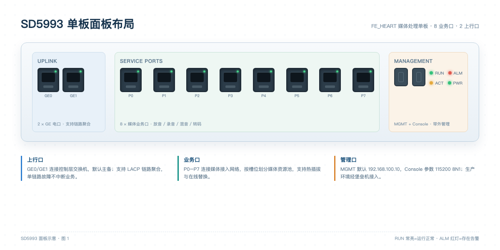

<!-- page: 1 -->
# SD5993 单板命令手册

SD5993 是 FE_HEART 媒体层的媒体处理单板，提供放音、录音、会议混音、视频转码和 DTMF 检测能力。单板支持热插拔，业务运行中更换单板不会影响其他槽位的媒体业务。

## 1. 面板与端口



图 1 SD5993 单板面板布局

- 上行口：GE0/GE1，连接控制层交换机，支持链路聚合。
- 业务口：P0 至 P7，连接媒体接入网络。
- 管理口：MGMT，带外管理，默认地址 192.168.100.10。
- 指示灯：RUN 绿色常亮表示运行正常，ALM 红色表示存在告警。

## 2. 常用命令

| 命令 | 作用 | 示例 |
| --- | --- | --- |
| display board | 查看单板状态与温度 | display board 3 |
| reset board | 复位指定槽位单板 | reset board slot 3 |
| set trunk | 配置中继组与中继成员 | set trunk 1 group 2 |
| show call | 查看活动呼叫与媒体资源 | show call all |
| display media | 查看媒体资源占用率 | display media slot 3 |

## 3. 登录方式

通过 Console 口登录需要使用 115200 8N1 参数；通过管理口登录使用 SSH，默认账号为 admin，首次登录必须修改密码。生产环境建议通过堡垒机接入，禁止直接暴露管理口到办公网络。

<!-- page: 2 -->
## 4. 复位单板

复位 SD5993 单板使用命令 `reset board slot 3`，其中 3 为槽位号。执行命令前必须确认该槽位没有承载正在进行的会议或录音业务，否则会导致媒体中断。

复位操作的标准步骤：

1. 执行 `display board 3` 确认单板当前状态和承载业务。
2. 执行 `show call all` 检查是否存在使用该单板媒体资源的活动呼叫。
3. 在维护窗口执行 `reset board slot 3`，等待单板重新上线。
4. 执行 `display board 3` 确认单板状态为 Normal，并检查告警是否恢复。

## 5. 配置示例

```text
# 将 1 号中继组绑定到 2 号中继群
set trunk 1 group 2

# 查看 3 号槽位媒体资源占用
display media slot 3
```

## 6. 注意事项

- 复位单板会中断该单板上的所有媒体业务，必须提前通知业务部门。
- 单板固件升级使用 `upgrade board slot 3 file sd5993-v2.3.bin`，升级过程中禁止断电。
- 更换单板后需要执行 `display board` 确认序列号与资产台账一致。
