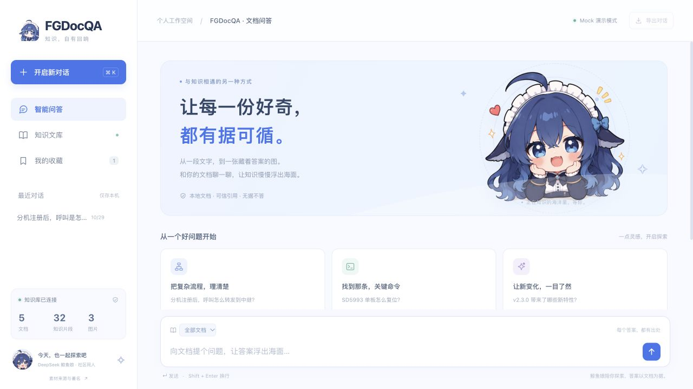

# FGDocQA · 文档问答工作台

课程项目介绍 · 2026-11-16
提交人：见班级个人材料文件夹



## 项目概述

FGDocQA 是一个在本机运行的文档问答项目。它将 PDF、Word、PPT、Markdown 和 TXT 的正文及支持格式的内嵌图片整理为知识库，检索相关内容后生成附来源的回答，让使用者能够从答案继续核对原文。

本项目提供可直接启动的 Mock 演示程序，并保留通过 HTTP 接入真实 Embedding、Reranker、Chat 和视觉模型的工程能力。课程提交包以不需要 API Key 的 Mock 模式作为默认验收入口，便于离线复现。

源码仓库：[zzhseu1108/HUAWEIhomework-FGDocQA](https://github.com/zzhseu1108/HUAWEIhomework-FGDocQA)

## 主要功能

| 功能 | 具体实现 |
| --- | --- |
| 多格式解析 | 支持 `.pdf`、`.docx`、`.pptx`、`.md`、`.markdown`、`.txt`，生成结构化 Markdown、图片与元信息 |
| 图文检索 | 图片描述与正文共同入库；真实视觉模型可通过配置接入，Mock 使用图注与规则释义 |
| 三路召回 | 稠密向量 + BM25 + 本地 TF-IDF 稀疏检索，经 RRF 融合与精排 |
| 问答溯源 | 回答附文档、页码、引用片段和图片信息；检索依据不足时返回“无据不答” |
| 浏览器工作台 | 知识文库、分类筛选、分页阅读、图片预览、会话历史、收藏、复制和 Markdown 导出 |
| 开发工具 | 命令行解析、建库、查询、评估、目录监控、配置检查与接口探测 |

## 技术结构

```text
浏览器 / 命令行
        ↓
Agent：问题分析、检索编排、充足性判断、回答与引用
        ↓
DocBase：语义切片、三路检索、RRF 融合、精排
        ↓
doc2md：正文解析、图片提取、图片释义、来源元信息
        ↓
统一模型层：Mock 实现 / HTTP 模型端点
```

后端主要使用 Python 标准库，前端为 HTML、CSS 和 JavaScript，不依赖前端构建工具。PDF 解析另用 `pypdf` 与 `Pillow`。跨层数据通过各层 `models.py` 中的契约传递。

## Mock 与 API 的区别

| 项目 | 默认 Mock 演示 | HTTP API 模式 |
| --- | --- | --- |
| 运行条件 | 无需 Key，无需下载大模型 | 需要可用端点、模型 ID 和相应凭据 |
| 向量与精排 | 可复现哈希向量、词面规则 | 调用真实 Embedding / Reranker |
| 图片与回答 | 图注规则释义、检索片段式回答 | 启用对应能力后由视觉 / 聊天服务处理 |
| 用途 | 功能演示、开发和课程验收 | 体验真实模型的检索与生成能力 |

四类能力可以分别配置，部分 HTTP、部分 Mock 时属于混合模式。真实服务必须通过 `probe` 单独验证；配置了模型名或填入 Key，不等于已经连通。当前稀疏路是 `tfidf-local`，没有将其冒称为 BGE-M3 的学习型稀疏检索。

## 交付与验收

本次交付分为源码、Windows / macOS 可执行程序、介绍材料三部分。可执行程序包含所需 Python 运行时和演示资源，完整解压后启动，无需另装 Python；源码版保留完整高级配置与开发入口。

建议验收顺序：启动对应系统的程序 → 确认 Mock 模式和鲸鱼娘首页 → 点击示例问题 → 打开回答引用与文库原文 → 收藏或导出回答 → 关闭运行终端结束服务。

原有工程测试集为 38 项，覆盖解析、索引、召回、问答、Web 接口和 HTTP 协议校验；HTTP 测试使用模拟响应，不代表真实云端令牌已通过鉴权。本次打包程序的构建及自检情况，以随包验证记录为准。

## 当前边界

- 默认是个人本机应用，没有多用户登录与权限管理；服务监听 `127.0.0.1`。
- Mock 不代表真实语义模型效果；API 模式会向所配置服务发送相应文本，启用真实视觉能力时还会发送图片。
- DOCX 页码为估算；扫描 PDF 没有完整 OCR 流程，部分矢量图片格式会跳过并告警。
- 会话与收藏仅保存在当前浏览器；每次问题独立检索，不把完整历史作为聊天上下文发送。
- 演示语料为虚构场景，不能当作真实产品操作手册。

界面鲸鱼娘采用社区已有素材。作者、来源和 CC BY-NC-SA 4.0 许可随源码保留，详见源码中的 `src/docqa/web/static/ARTWORK-LICENSE.md`。本项目使用同人形象不代表与 DeepSeek 官方存在关联。
